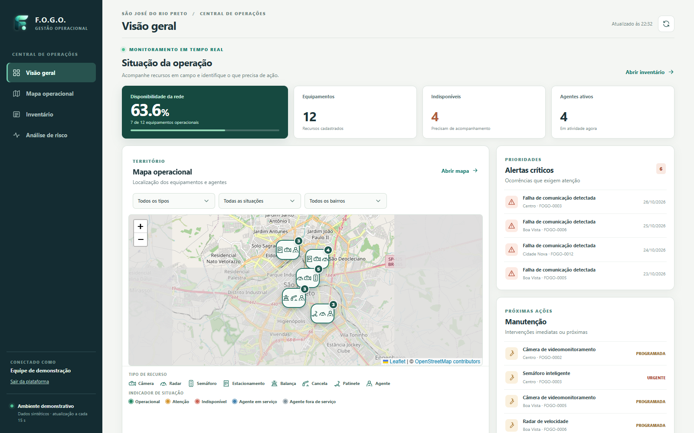
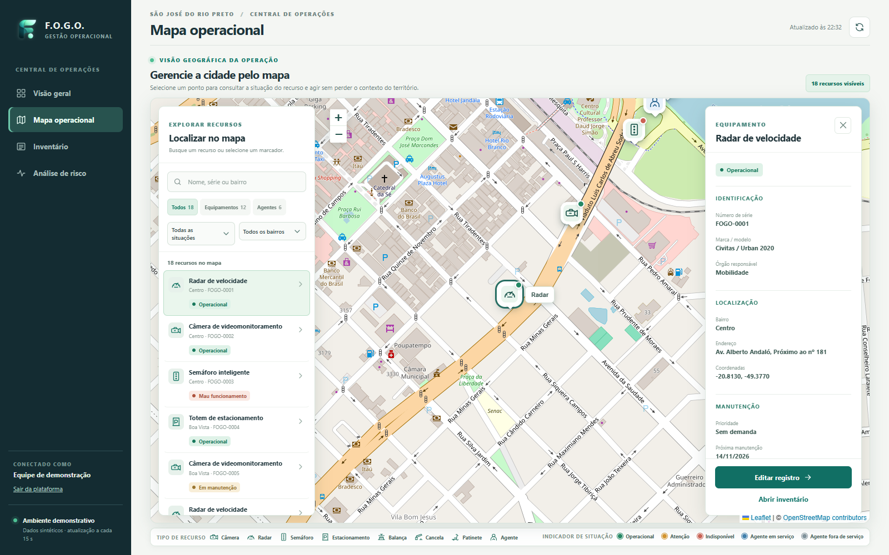
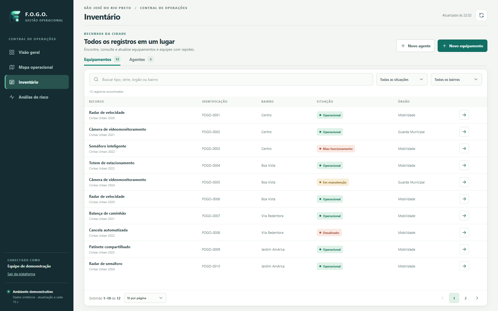
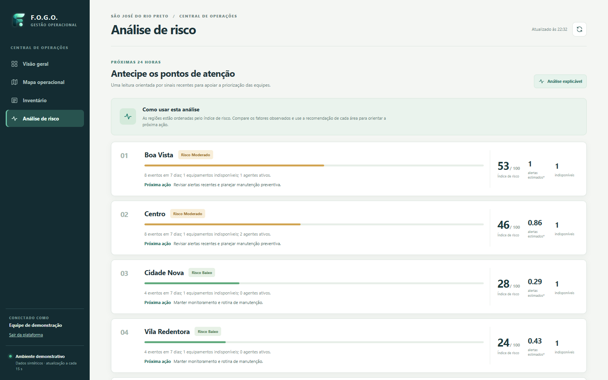

# F.O.G.O. — Central Inteligente de Operações Urbanas

Solução da etapa bônus do **DSIN Coder Challenge**, com inventário, central operacional e análise preventiva. O backend usa Laravel 13 e SQLite; a interface usa React 19, Vite e CSS responsivo. Os dados iniciais são **sintéticos** e representam São José do Rio Preto apenas como cenário de demonstração.

## Requisitos

- PHP **8.5.12 ou superior dentro da série 8.5**, com `curl`, `fileinfo`, `mbstring`, `openssl`, `pdo_sqlite`, `sqlite3` e `zip` habilitados.
- Composer 2, Node.js 24 e npm 11.
- Porta 8000 livre para a execução padrão ou 8778 para o ambiente com banco limpo.


## Iniciar com dados demonstrativos

No diretório `backend`:

```powershell
composer install
Copy-Item .env.example .env
php artisan key:generate
php artisan migrate --seed
npm ci
npm run build
php artisan serve
```

Acesse `http://127.0.0.1:8000`. A página inicial oferece cadastro e login; após entrar, a plataforma fica em `/platform`. A interface e a API são servidas pela mesma origem. Para desenvolvimento do frontend, execute `npm run dev` em outro terminal. O seed é idempotente: só adiciona dados quando o inventário está vazio.

## Build e execução com banco limpo

O frontend tem **um único build** para os dois ambientes. O comando `npm run build` compila React e CSS em `backend/public/build`; ele não cria nem preenche bancos de dados. O banco usado é definido quando o servidor Laravel inicia.

Para preparar uma instalação nova, execute na raiz do projeto:

```powershell
cd backend
composer install
Copy-Item .env.example .env
php artisan key:generate
npm ci
npm run build
powershell -NoProfile -ExecutionPolicy Bypass -File .\scripts\start-clean.ps1
```

No Linux ou macOS, após instalar PHP, Composer e Node.js nas versões indicadas, execute `sh scripts/start-clean.sh` dentro de `backend`. O argumento opcional é a porta, por exemplo `sh scripts/start-clean.sh 8780`.

Em uma instalação já preparada, execute apenas `npm run build` após mudanças no frontend e inicie o servidor com `powershell -NoProfile -ExecutionPolicy Bypass -File .\scripts\start-clean.ps1`. Não copie `.env.example` sobre um `.env` existente nem execute `php artisan migrate --seed` para preparar o banco limpo.

Acesse `http://127.0.0.1:8778/`. O script cria `backend/database/clean.sqlite` se necessário, aplica as migrações **sem seed** e inicia o Laravel na porta 8778. O banco demonstrativo `backend/database/database.sqlite` não é modificado; a demonstração pode continuar aberta em `http://127.0.0.1:8777/` neste workspace. Cada ambiente tem um cookie de sessão distinto. Para encerrar o servidor limpo, pressione `Ctrl+C`. Se a porta 8778 estiver ocupada, acrescente `-Port 8780` ao comando e acesse a porta escolhida.

Esse fluxo usa SQLite e o servidor local do Laravel; não é preciso iniciar Apache ou MySQL no XAMPP.

Os cadastros feitos no ambiente limpo persistem após reiniciar o servidor. Crie uma conta própria nele: usuários e recursos ficam no banco separado. Na primeira visita à plataforma, a visão geral orienta o cadastro de equipamentos e agentes. Os indicadores, o mapa e a análise passam a usar esses dados. A telemetria pode ser enviada pela API por uma sessão autenticada; o cadastro manual não gera eventos automaticamente. Este modo serve para testar o fluxo do zero, mas ainda não tem perfis de acesso nem integrações reais de coleta de dados. Não publique o servidor local na internet.

Não copie arquivos `.sqlite` de outro ambiente para uma instalação nova; o script prepara o banco limpo no destino.

## Funcionalidades

1. **Inventário:** cadastro, consulta, atualização e exclusão de equipamentos e agentes; catálogo padronizado de tipos de equipamento servido pela API, consulta de CEP com preenchimento de endereço, busca textual, filtros por situação e bairro, paginação com tamanho de página configurável, localização, manutenção e características específicas em JSON. Validação no servidor e número de série único. Em telas pequenas, os registros aparecem em cartões legíveis com a mesma paginação.

2. **Central de operações:** mapa interativo OpenStreetMap georreferenciado, filtros, disponibilidade da rede, alertas críticos, manutenção prioritária e resumo por bairro. Há uma tela própria de gerenciamento pelo mapa, com busca, filtros por tipo, situação e bairro, seleção de marcadores, painel de detalhes e edição direta do recurso. Alertas e intervenções também abrem o recurso relacionado. A interface atualiza a cada 15 segundos. Eventos novos podem entrar pela API de telemetria.


3. **Análise de risco:** índice de prioridade por bairro, comparação dos alertas nas últimas 24 horas com a base dos sete dias anteriores, estimativa de alertas para as próximas 24 horas, dias com telemetria e erro retrospectivo. Evidências e ações recomendadas aparecem por região. A estimativa é um modelo estatístico simples e explicável; não representa probabilidade calibrada ou previsão causal. Quando não há histórico suficiente, a interface mostra essa limitação em vez de um número.

### Cenário de demonstração

Uma instalação nova com `php artisan migrate --seed` gera quatro semanas de eventos **sintéticos**. Há um aumento recente de alertas no Centro para mostrar o fluxo de análise. Após criar uma conta e entrar na plataforma:

1. Abra **Visão geral** e confira os alertas e a disponibilidade.
2. Abra **Mapa operacional** e localize os recursos do Centro.
3. Abra **Análise de risco**: compare alertas das últimas 24 horas, base diária, dias com telemetria e erro retrospectivo. O indicador de aumento aponta uma mudança observada; a recomendação orienta a investigação.

O seed não altera um inventário já preenchido. Para repetir exatamente o cenário, use uma instalação nova ou outro banco SQLite vazio. O fluxo de telemetria pode ser validado pelo endpoint autenticado `POST /api/telemetry`; os testes automatizados exercitam esse percurso.

## Telas do sistema

As capturas abaixo mostram o ambiente demonstrativo com dados sintéticos.

### Página inicial

Apresenta a plataforma e direciona para cadastro ou acesso à central.


### Visão geral

Reúne disponibilidade, recursos, alertas, manutenção e uma visão rápida do território.



### Mapa operacional

Permite localizar e filtrar recursos; ao selecionar um item, exibe seus detalhes e a ação de edição.



### Inventário

Organiza equipamentos e agentes com busca, filtros, paginação e acesso aos registros.



### Análise de risco

Ordena regiões por índice de risco e apresenta os fatores observados e a próxima ação sugerida.




## API

Todas as rotas `/api/*` exigem uma sessão autenticada do Laravel. A página inicial (`/`), o cadastro (`/register`) e o login (`/login`) são públicos para permitir o acesso; `/platform` e `/logout` exigem login. Requisições de escrita feitas no navegador devem enviar o token CSRF. A senha do cadastro deve ter pelo menos 12 caracteres, letras e números. O login regenera a sessão, e a saída a invalida. Cada ambiente tem seu próprio banco e cookie de sessão; dentro do mesmo ambiente, os registros operacionais são compartilhados pelos usuários cadastrados.

Esta autenticação atende ao uso interativo no navegador. Antes de conectar sensores ou sistemas externos, será preciso implementar credenciais de integração com escopo e rotação próprios. O projeto ainda não oferece recuperação de senha, verificação de e-mail, papéis ou trilha de auditoria.

| Método | Rota | Uso |
|---|---|---|
| GET, POST | `/api/equipment` | Listar, filtrar e cadastrar equipamentos |
| GET | `/api/equipment-types` | Tipos aceitos no cadastro de equipamentos |
| GET | `/api/postal-codes/{cep}` | Consultar endereço e coordenadas disponíveis para um CEP de oito dígitos |
| GET, PUT, DELETE | `/api/equipment/{id}` | Consultar, atualizar e excluir equipamento |
| GET, POST | `/api/agents` | Listar e cadastrar agentes |
| GET, PUT, DELETE | `/api/agents/{id}` | Consultar, atualizar e excluir agente |
| POST | `/api/telemetry` | Registrar evento e, opcionalmente, atualizar status |
| GET | `/api/events` | Eventos recentes |
| GET | `/api/dashboard` | Indicadores e alertas |
| GET | `/api/forecast` | Índice e recomendações por bairro |

A consulta de CEP usa a [BrasilAPI CEP V2](https://brasilapi.com.br/docs), com cache de sete dias para resultados encontrados. Rua, bairro, cidade e UF são preenchidos quando disponíveis e permanecem editáveis. As coordenadas podem estar ausentes ou ser aproximadas; confira o ponto antes de salvar. Referência e demais detalhes do local continuam manuais. A conexão HTTPS valida o certificado com o pacote CA em `backend/resources/certs/cacert.pem`, incluído na distribuição; veja as instruções de atualização nesse diretório. Se o serviço estiver indisponível, o cadastro pode ser preenchido manualmente.

Exemplo de telemetria:

```json
{
  "equipment_id": 3,
  "kind": "device_health",
  "severity": "critical",
  "description": "Falha de comunicação detectada",
  "status": "malfunction"
}
```

## Arquitetura

- `backend/app/Models`: entidades Eloquent e conversão de campos JSON.
- `backend/app/Http/Requests`: validação de entrada.
- `backend/app/Http/Controllers`: endpoints enxutos.
- `backend/app/Services/OperationsService.php`: cálculos do painel e índice de risco.
- `backend/app/Services/TemporalForecast.php`: séries de 24 horas, detecção de aumento e verificação retrospectiva da estimativa.
- `backend/database`: migração e dados sintéticos de demonstração.
- `backend/resources/js`: cliente API, hook de atualização e componentes React separados por tela e responsabilidade.
- `backend/resources/css`: tokens visuais e estilos divididos por área, com regras responsivas próprias.
- `backend/tests/Feature`: testes de fluxos completos da API.

O índice de prioridade usa `4 × severidade ponderada (crítico = 3; aviso = 1) + 12 × equipamentos indisponíveis − 3 × agentes ativos`, limitado a 0–100. A estimativa para as próximas 24 horas é a média entre os alertas das últimas 24 horas e a média diária dos sete dias anteriores. Ela só aparece com telemetria em pelo menos cinco desses sete dias e três alertas na base. Um aumento é sinalizado quando há ao menos três alertas recentes e crescimento de 80% ou de dois alertas sobre a base. O erro retrospectivo mede o desvio médio absoluto em 20 janelas anteriores, quando há pelo menos 21 dias com telemetria e 10 alertas no histórico. Esses indicadores devem ser recalibrados e validados com dados reais antes de apoiar decisões operacionais.

## Verificação

No diretório `backend`, após `composer install` e `npm ci`:

```powershell
php artisan test
npm run build
```

Os testes cobrem autenticação, cadastros, telemetria, instalação vazia, cálculo temporal e o cenário demonstrativo. O pacote de entrega é gerado na raiz com `python package_release.py`; ele inclui o build do frontend e exclui bancos, segredos, dependências instaladas e ferramentas locais.

O repositório executa os mesmos testes PHP e o build React no GitHub Actions a cada push ou pull request.


**Uso de IA:** OpenAI Codex auxiliou na implementação, revisão do enunciado e documentação.
